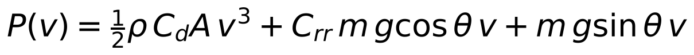

# About this document

This document describes the Peloton Phase Lab using the ODD protocol (Overview, Design concepts, Details; Grimm et al. 2020). The model runs in a web browser and is written in JavaScript. It is based on the author's NetLogo model of peloton dynamics and on the measures in Trenchard, Recchia and Perc (2026), *Braid Complexity and Peloton Phase Dynamics* (SportRxiv preprint, under review).

The JavaScript implementation was written with the assistance of Claude (Anthropic), based on the author's NetLogo model, and was directed, tested and reviewed by the author.

# 1. Purpose and patterns

**Purpose.** The model shows how a group of cyclists (a peloton) moves between collective phases as the pace or road gradient changes. Each rider tries to save energy by drafting, keep in contact with the group and move up when able, subject to its own maximal sustainable power output (MSO). The model is mainly for teaching and exploration. It lets users see how individual energy limits and drafting produce compact, mixing, stretched and fragmented group states, and how two measures from the paper track them:

- the peloton convergence ratio (PCR), a measure of collective effort; and
- positional complexity (Cx\*), a measure of how much riders reorder, based on braid theory.

**Patterns the model should reproduce.** These come from the paper's empirical Scratch-race data and from observation of races:

1. At low PCR the group is compact. Riders move up the sides and drift back after a turn at the front, so the positional order mixes continually (convective reordering) and Cx\* is high.
2. As PCR approaches the passing threshold, riders can follow but not overtake. The group narrows into a single-file line and Cx\* falls (the stretched phase, S).
3. When PCR exceeds 1 for the weaker riders, they cannot hold a wheel even with shelter. Gaps open, riders behind them are dropped with them, and the group splits into sub-groups (Dcp).
4. After a hard effort, a stretched line can persist as the pace eases (Sf). The group's state depends on its recent history (hysteresis).
5. At easy pace a bunch tends to hold position until someone makes a move (tactical waiting).

# 2. Entities, state variables and scales

**Riders.** Each rider is an agent with these state variables:

| Variable | Meaning | Units |
|---|---|---|
| x, y | Position along and across the road | m |
| v | Speed | m/s |
| MSO | Maximal sustainable output (fixed per rider) | W |
| P | Current power output | W |
| d | Current drafting coefficient (1 = no shelter) | – |
| W′ balance, W′ capacity | Anaerobic reserve remaining and its maximum (60 J per watt of MSO) | J |
| mode | Riding, pulling at the front, swinging off, moving up, closing a gap, chasing, rejoining | – |
| group | The group the rider currently belongs to | – |
| capacity | Spare capacity to move up, from 1 (relaxed) to 0 (at the drafting limit) | – |
| preferred lateral slot | A rider's preferred position across the road (set at random) | m |

**Groups.** Groups are derived each step from the riders' positions. Riders whose wheel gap is more than 6 m for 2 s belong to separate groups, and groups merge again when the gap falls below 3 m. Each group has a head and tail position, a speed, a chase speed and an activity level used for tactical waiting.

**Environment.** A straight road 15 m wide, with a uniform gradient between −2 % and 8 % and no wind. Each rider-bicycle is 1.8 m long (centre to centre).

**Scales.** Time advances in steps of 0.05 s. The group measures (PCR, ahead-counts, Cx\*, CxP\*, phase labels) are computed once per simulated second, as in the paper. Runs are open-ended; the user stops or resets them. The default field is the 12 riders of the paper's Scratch race, and users can choose 6 to 100 riders.

# 3. Process overview and scheduling

Each 0.05 s step covers these processes, broadly in this order:

1. **Groups.** Assign riders to groups from the current wheel gaps.
2. **Shelter.** Compute each rider's drafting coefficient d from the riders ahead (submodel 7.2).
3. **Decisions.** Each rider updates its mode:
   - the front rider of each group pulls, then swings off (7.5);
   - riders with capacity may start a move up (7.6, 7.7);
   - riders who see a gap opening ahead decide whether to close it (7.4);
   - riders off the back of a relaxed bunch try to rejoin (7.8);
   - trailing groups decide whether to chase (7.4).
4. **Steering.** Apply cohesion, separation, the drift toward the middle of the road and the drafting line to set lateral movement (7.3).
5. **Power and speed.** Each rider chooses a power, capped by its MSO and W′ (7.1). Speed then follows the balance between that power and the power needed at the current speed and shelter.
6. **Energy.** W′ drains above MSO and recovers below it.

Once per simulated second the model samples the group measures and phase labels (7.9, 7.10).

# 4. Design concepts

**Basic principles.** Energetic coupling through drafting (the PCR) and positional reordering measured with braid complexity (Cx\*), as set out in the paper. Riders are self-interested and energy-limited. Collective phases are not programmed; they emerge from those limits.

**Emergence.** Group shape, width, mixing rate, splits, chases and the phase sequence all emerge from the riders' local rules and energy limits.

**Adaptation.** Riders choose between holding position, moving up, closing gaps, chasing and rejoining, based on their remaining capacity and W′.

**Objectives.** Implicit: stay sheltered, stay in contact, and improve position when it is affordable.

**Sensing.** Riders sense the positions and speeds of nearby riders within forward cones (the drafting, cohesion and separation zones), the gap ahead of their wheel, and their own power and W′.

**Interaction.** Interactions are indirect, through shelter (drafting) and through space (blocking, cohesion and separation).

**Stochasticity.** Random elements are: the riders' MSOs when they are drawn at random, preferred lateral slots, pull lengths, rejoin positions after a pull, the timing of move-up attempts, unprompted moves during tactical waiting, and the pace schedule of the random-fluctuations experiment. Each run has a seed, which is recorded in the exports; the same seed and settings reproduce a run exactly.

**Collectives.** Groups, which split and merge as gaps open and close.

**Observation.** See 7.9 and 7.10. The interface shows PCR, Cx\*, CxP\*, ΔPCR, the phase label, the braid diagram, a trace of PCR against Cx\*, stretch and splits over time, phase occupancy, and per-group and per-rider tables. Group history, rider data and group observations can be exported as CSV files.

# 5. Initialization

- **Riders.** By default, the 12 Scratch-race MSOs from the NetLogo model: 250, 251, 283, 290, 216, 323, 337, 215, 247, 262, 282 and 255 W (mean 268 W). With 12 riders each value is used once; with other numbers, MSOs are drawn with replacement. Users can instead draw MSOs at random between the current minimum and maximum, use a realistic range for a rider category, spread them evenly around a centre, or enter a custom list.
- **Starting grid.** Up to 30 riders start in two staggered rows, half the field in each, side by side 1.1 m apart and centred on the road. Larger fields start spread across the road's whole width in as few rows as that allows.
- **Starting state.** All riders start at the requested pace with full W′.
- **Defaults.** Pace 34 km/h, grade 0 %, drafting coefficient d = 0.62, urge to move up 1.2, tactical waiting on.

# 6. Input data

No external input data. The default MSOs come from the paper's Scratch-race analysis (12 riders, 20 laps of a 333 m velodrome, about 10 minutes).

# 7. Submodels

## 7.1 Power and speed

The power needed to ride exposed at speed v (the paper's Eqs. 1–2) is

{width=4.6in}

with the NetLogo parameters reported in the paper: ρ = 1.226 kg/m³, CdA = 0.32 m², Crr = 0.004, m = 75 kg (rider and bicycle), g = 9.81 m/s², and θ = atan(grade). A sheltered rider needs d × P(v).

A rider's power is capped at MSO × (1 + √(W′ remaining / W′ capacity)), so it can exceed MSO only while it has reserve. W′ is part of this model's rider rules, not of the paper's analysis: PCR, Cx\*, CxP\* and the phase labels do not use it. Without W′, riders cannot close the small gaps that open as others pull, pass or wobble. In tests with 16 riders over 5 minutes (4 seeds), a field at 38 km/h (group PCR 0.60) then split into about 4 groups with 8 riders behind, against 1.1 groups and 0.2 riders behind with W′.

## 7.2 Drafting (shelter)

Shelter follows the NetLogo model's draft cones:

- If more than one rider is ahead within the draft zone in a 60° cone, d follows Olds' formula from the nearest of them. With wheel gap w in metres, d = d₀ − 0.0104 w + 0.0452 w², capped at 1 (the paper's Eq. 5). The intercept d₀ is set by the drafting-coefficient control (default 0.62).
- Otherwise, d comes from the nearest rider in a 10° cone.
- If there is no rider in either cone, d = 1.

Olds' spacing is measured as the wheel gap, because riders here have a bike length; NetLogo's agents are points.

## 7.3 Cohesion, separation and steering

As in the NetLogo model:

- **Cohesion.** Each rider is pulled toward the mean position of riders within 20 m in a 140° cone ahead, at 0.11 per second along the road and 0.07 across it. The forward pull is limited to 0.33 m/s per metre of room ahead, to the wheel followed, and to the wheel in the rider's own lane, because speeding up costs power.
- **Separation.** Each rider is pushed away from riders within 1.5 m in a 240° cone, at 0.05 m/s per neighbour.
- **Middle of the road.** Every rider drifts toward the middle of the road at 0.02 m/s, except when passing on the outside. A rider never drifts into the line directly behind a rider just ahead.
- **Drafting line.** A rider in the wind steers to within 0.15 m of its wheel's line, inside the 10° cone. A rider who already has shelter holds its line.
- **Lulls.** Lateral drifts pause during a lull (see 7.7).

## 7.4 Gap closing, splits and chasing

- **Losing a wheel.** A rider counts as losing a wheel when a gap of more than 2 m keeps opening for 1 s.
- **Closing a gap.** Riders behind react as soon as a gap opens ahead of their wheel. They come round and close it if that costs less than 90 % of their remaining W′; otherwise they stay behind and go with it.
- **Splits.** Groups separate when a wheel gap exceeds 6 m for 2 s, and rejoin when it falls below 3 m.
- **Bridging.** Within 80 m of the group ahead, a trailing group's leader rides hard to bridge, at the tail speed of the group ahead plus 0.4 × the gap (1–3 m/s faster), as far as its power allows.
- **Organised chase.** Further back, a trailing group chases at any distance, as long as its chase speed is above the speed of the group ahead. The chase speed is the lower of two speeds: what its stronger half can hold sharing the front (each spending 1/k of the time exposed), and what its weakest member can follow in shelter. While chasing, riders take turns of 8–12 s and swing off early only below 15 % W′.

## 7.5 Pulls at the front

Each group's front rider aims for the requested pace for 15–30 s (up to three times longer during a lull). It stops early if it cannot hold the pace, or if its W′ falls below 70 % (40 % when the group's PCR approaches the paper's high threshold, 0.738). It then swings off into a free corridor 1.4 m to the side and drifts back. Below threshold it slips into a free sheltered slot within the first 10 riders. At threshold it drifts further back; the user can choose this behaviour ("After a pull, rejoin").

## 7.6 Moving up

- **Capacity.** A rider's capacity runs from 1, when its own sheltered PCR at the group's speed is 0.488 or less, down to 0 when that PCR equals d₀. Capacity sets how many riders it may pass in the wind before tucking in: up to 10, and none at zero capacity.
- **Room and the passing rule.** A move needs room beside the rider to step out, toward the nearer flank if possible; a rider boxed in on both sides waits. Riding in the wind faster than the group must be sustainable: the exposed power at the group's speed + 0.8 m/s must not exceed MSO. In a relaxed bunch (group PCR about 0.55 or less), a rider with capacity may instead use W′, if the pass costs less than half of what remains.
- **Passing.** A rider passing on the outside angles in gradually (at most 0.25 m/s sideways), keeping 0.8 m outside the riders it passes, then tucks into a slot just ahead on a diagonal. A rider boxed in during a move eases off by 0.15 m/s to slip out, and gives up after 3 s.
- **Easing back.** Riders also ease back through the bunch now and then. Together with pulls and moves up, this produces the convective reordering.
- **Urge to move up.** This rule is the model's own and is not discussed in the paper. A rider's chance of starting a move each second is 0.5 × urge × (a + b) × lull factor, where:
  - a = (0.25 + 0.6 × rank from the front, 0 to 1) × capacity;
  - b adds up to 0.6 for a rider in the back third, however weak, as long as it has some capacity.

  At the default urge of 1.2, a rider at the back with full capacity tries about every 1.2 s once it has room. At 0, nobody moves up.

## 7.7 Tactical waiting

At easy pace a bunch tends to hold position until someone makes a move. Tactical waiting is fully on when the group's PCR at the requested pace is 0.45 or less, fading out by 0.55 (about 36 km/h for the Scratch field). The lead group has an activity level that fades over about 10 s. About once every 40 s, a rider with spare capacity makes an unprompted move. This lifts activity and sets off a burst of follow-on moves, which then dies away. Moving up, easing back and lateral drifts are scaled down when activity is low; this quiet state is a lull.

## 7.8 Getting back in

In a relaxed bunch, a rider further behind the group's head than the bunch's compact length (about 2.2 m × √N, with N the riders in the group) is off the back. This happens after a surge or a mishap has strung the bunch out. Such riders try to get back in even if it takes them close to their threshold, while the riders at the front hold the pace. They move up whatever the lull, with an urge that grows with how far back they are. They may pass as many riders as it takes, on W′ down to 25 %, and close up in their own lane when there is room, at up to 1.2 m/s above the group's speed.

## 7.9 Measures (sampled each second)

- **PCR.** For each rider, PCR_i = P_front × d₀ / MSO_i (the paper's Eq. 4), with a fixed d₀. By default P_front is the power needed to ride the requested pace, as in the NetLogo model; optionally, it is the lead group's front rider's actual speed. Group PCR is the mean over riders. A rider with PCR_i above 1 cannot hold the pace even when sheltered.
- **Ahead-counts.** For each rider, the number of riders more than 1 m ahead of it and within 1 m laterally.
- **X.** The number of riders whose ahead-count changed since the previous second, as in the NetLogo model's calculate-positions.
- **Positional complexity.** Cx\* = 1 + ln(1 + 12X/N), normalised to the paper's 12-rider reference group.
- **Coupled index.** CxP\* = PCR × Cx\*.
- **Direction of change.** ΔPCR is the change in group PCR from one second to the next. For the labels, PCR is first averaged over 5 s centred on each second, so labels appear 2 s late. A change counts as rising or falling only if it exceeds ε = 0.10 × the standard deviation of ΔPCR so far in the run; smaller changes count as steady.
- **Stretch.** A group counts as stretched when its longest single-file line holds at least 4 riders and at least 40 % of the group. In a single-file line, each rider is directly behind the one ahead: no more than 0.5 m to the side, no more than 3 m back, and with nobody alongside. Riders swinging off after a pull are not counted.

## 7.10 Phase labels

The labels follow the paper's Section 2.8, with thresholds standardised on the Scratch race: PCR_low = 0.488, PCR_high = 0.738, Cx_low = 1.693 and Cx_high = 2.099. The rules are applied in this order:

| Label | Plain name | Rule |
|---|---|---|
| Dcp | Breaking apart | PCR > 1 |
| Da / Dd | Surging / Easing off | Cx\* ≥ Cx_high, PCR > PCR_low, and PCR rising / falling |
| S | Strung out | Cx\* ≤ Cx_low and PCR ≥ PCR_high |
| Sf | Strung out and tiring | Cx\* ≤ Cx_low, PCR between PCR_low and PCR_high, and falling |
| Cs | Compact and calm | Cx\* ≤ Cx_low and PCR ≤ PCR_low |
| Cch | Compact, mixing hard | Cx\* ≥ Cx_high and PCR ≥ PCR_high |
| Ccl | Compact and mixing | Cx\* ≥ Cx_high and PCR ≤ PCR_low |
| Transitional | In between | Any other combination |

**Formation check (the model's addition).** After the Dcp rule, if the lead group (3 or more riders) is stretched and its PCR is above PCR_low, the label is S, even if some reshuffling keeps Cx\* above Cx_low. It is Sf instead if the lead group's PCR is below PCR_high and PCR is falling. The exports record both this label and the label from the paper's rule alone. Sub-groups are labelled with a direction-free version of the rules, since a group's PCR series breaks when riders join or leave.

# 8. Relation to the NetLogo model

The browser model was written from scratch rather than ported line by line, but it is largely based on the author's NetLogo model. These parts follow it closely:

- the PCR, computed from the requested pace with a fixed d;
- the braid-complexity measures (ahead-counts, X, Cx\*, CxP\*);
- the power parameters;
- Olds drafting with the NetLogo draft cones;
- the cohesion and separation rules.

Riders here also have a bike length, momentum and an energy budget (W′). The rules for pulling, moving up, passing, gap closing, chasing, rejoining and tactical waiting are this model's own. They were adjusted by comparing the model with the NetLogo model and with what is seen in races.

# 9. Limitations

- No wind, cornering, team tactics or braking. The grade is limited to −2 % to 8 %, because on steeper descents the required power becomes negative and the PCR loses its meaning.
- The passing margin (0.8 m/s), W′ capacity (60 J per watt of MSO), pull rules and group-gap thresholds are illustrative assumptions.
- The phase thresholds were calibrated on a 12-rider race, so labels for very different rider counts should be read with care. The paper notes residual size effects at N = 50 and 100.
- All data are synthetic.

# 10. Running the model

Open `index.html` in any modern browser (Chrome, Firefox, Edge or Safari). No installation, server, build step or internet connection is needed. The automated checks run with Node.js: `node tests/model.test.js`.

# References

Grimm, V., Railsback, S. F., Vincenot, C. E., Berger, U., Gallagher, C., DeAngelis, D. L., et al. (2020). The ODD protocol for describing agent-based and other simulation models: A second update to improve clarity, replication, and structural realism. *Journal of Artificial Societies and Social Simulation*, 23(2), 7.

Olds, T. (1998). The mathematics of breaking away and chasing in cycling. *European Journal of Applied Physiology*, 77, 492–497.

Trenchard, H., Recchia, D. R., & Perc, M. (2026). Braid complexity and peloton phase dynamics. SportRxiv preprint (under review). https://sportrxiv.org/index.php/server/preprint/view/1164/version/1439
